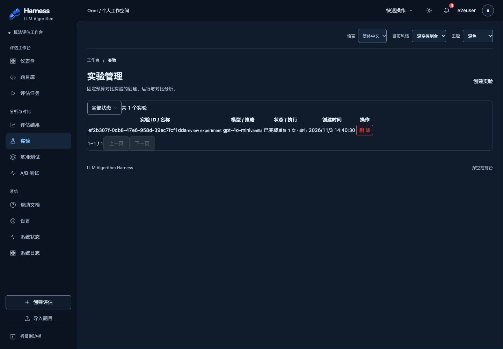
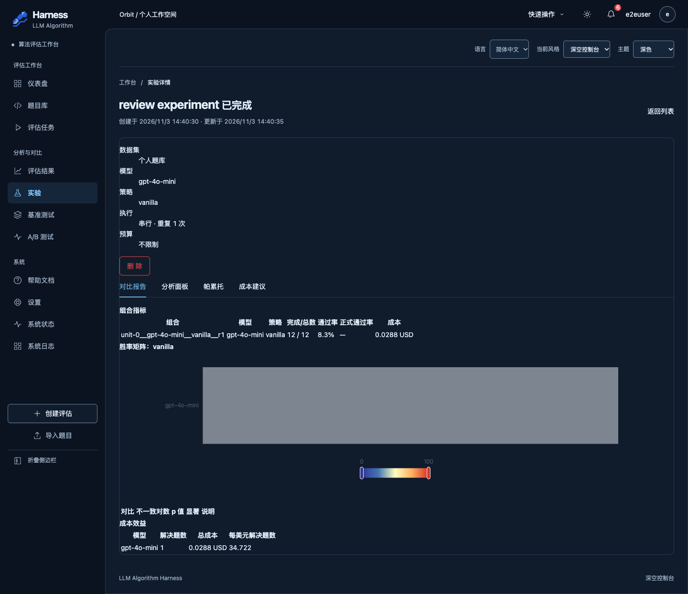

# 前后端完成度与功能可用性审查（2026-11-03）

- 仓库：`/Users/charlesleclerc/LLM-Algorithm-Harness`
- 分支：`main`
- 审查时提交：`859f33b9b5815d88a1f309519b68567230aeaa30`（2026-11-02，`feat(frontend): add benchmark history and restore selected run progress (#327)`）
- 工作区：审查开始时干净；本次未修改业务代码。审查结束后仅新增本报告。
- 审查方式：静态阅读 + 构建/静态检查 + 全量后端测试 + 隔离 SQLite/Redis 本地服务 + 真实 Chrome 浏览器 + 真实 Celery worker（solo）+ 本地 OpenAI 兼容替身。
- Comet 探针：`comet resume-probe` 返回 `classic` / `ask_user`，原因为“多个 active changes 需要 change name”，但 `candidates` 为空。本次是用户直接要求的独立只读审查，未挂到任何 Comet change，也未进入或恢复 Comet 工作流。
- CodeGraph：仓库根目录不存在 `.codegraph/`，本次未使用 CodeGraph。

> 重要边界：本报告中的“端到端通过”默认指**本地单机、同一文件系统、真实 API + 真实 SQLite + 真实 Redis/Celery（solo）+ 测试替身模型服务 + host 沙箱**。真实 Docker 沙箱、真实模型供应商、PostgreSQL 和 Docker Compose 生产拓扑均未验证；详见第 8 节。

---

## 1. 总体判断

### 1.1 前端完成情况

前端的业务面比 README 和 `docs/frontend/INTEGRATION.md` 所描述的状态完整得多：题目库、评估创建/列表/详情/实时进度、结果列表/详情、实验、基准、A/B、预算、定价、个人资料、API 密钥、管理员系统状态/日志、通知中心都已有真实 API 客户端和页面实现，不再是 Mock 页面。

但前端仍有三个明显问题：

1. **6 个页面在直接打开或刷新时缺少共享样式**，表格/面板重叠、内容挤成一行，实验和 A/B 模块在“深链接/刷新”场景下几乎不可用。见问题 P0-3。
2. **报告下载在 UI 上被错误地禁用**：后端 `/reports/*` 对新评估可用，但前端因 `run_id === null` 显示“暂不可下载报告”。见问题 P1-1。
3. **生产交付物缺失**：仓库没有前端 Dockerfile、没有前端 compose 服务，nginx 把所有路径代理给 API；API 不提供 SPA 静态文件，`/login` 直接 404。见问题 P0-1。

工程检查方面：`npm test` 313 项通过，`npm run build`、`npm run lint` 通过；`npm run format:check` 因 `scripts/verify-settings.mjs` 失败。

### 1.2 后端完成情况

后端路由组全部注册，核心业务服务不是占位实现：

- 评估：创建草稿 → `/start` 入队 Celery → worker 加载题目/密钥 → `AlgorithmHarness` 执行 → 逐单元落库 → 结果查询/报告生成。
- 实验、基准、A/B：都有持久化记录、任务入队、执行器、结果查询和费用记录。
- 认证：httpOnly Cookie + CSRF 双提交、refresh 轮换、logout 撤销、角色白名单、跨用户资源隔离。
- 费用/预算/预警/定价：有真实写库和查询。
- 监控/日志/通知/WebSocket：管理员监控、保留日志、通知收件箱、Redis Pub/Sub 进度推送均真实存在。

全量后端测试在当前环境为 **3679 passed, 11 skipped（约 8 分 17 秒）**；`ruff check .` 和 `black --check .` 通过。CI 的 `mypy src/ --ignore-missing-imports` 在当前环境仍有 4 个错误，见问题 P1-4。

真实执行链在本机受两个环境前置限制：

- **Docker 不可用**：默认 `SandboxConfig(backend="docker")`，评估在 preflight 阶段失败并给出明确错误；本报告的成功执行使用仅存在于 `/tmp` 的 host 沙箱测试替身。
- **Celery 5.6.3 的 prefork worker 在本机崩溃**：最小 Celery 应用可复现 `ValueError: not enough values to unpack (expected 3, got 0)`；solo worker 正常。该问题不是仓库代码的专属 bug，但项目未锁定 Celery/billiard 版本，且未在 CI 中启动真实 worker，见问题 P1-3。

### 1.3 前后端联调完成情况

在“单机同文件系统 + 真实 API/SQLite/Redis/Celery + 测试替身模型 + host 沙箱”的条件下，以下链路实际走通：

- 注册 → 登录 → `/users/me` → 角色读取 → Cookie/CSRF 刷新 → 登出。
- 导入题目 → 创建评估 → 启动 → worker 执行 → 逐单元落库 → 结果列表/详情 → 报告 API 下载。
- 创建实验 → 运行 → 完成 → 结果/对比/面板 API；浏览器列表/详情有数据。
- 创建基准套件 → 无预算运行 → 完成 → 准确率/学习曲线。
- 创建 A/B → 运行 → 完成 → 结果 API。
- 暂停 → 恢复 → 完成；取消；WebSocket 订阅收到 snapshot/progress/completed。
- 管理员系统状态/日志；普通用户访问管理员路由返回 403；跨用户访问评估/结果/报告/实验/基准/A-B 返回 404。

但“生产拓扑”没有走通，且代码与编排证据显示它会失败：

- 前端没有部署入口。
- 实验/A/B 的结果和检查点写在 worker 本地相对路径 `results/`，生产 compose 没有共享或持久化该目录；API 在另一个容器中读不到。
- worker 镜像没有创建 `/app/results`，容器以非 root 用户运行，写入该目录的权限也不成立（静态推断，未在 Docker 中实测）。
- 真实 Docker + 真实供应商 + PostgreSQL + nginx 均未验证。

### 1.4 当前适合什么场景

| 场景 | 结论 | 依据 |
|---|---|---|
| 本地试用 | **有条件可用** | 需要本机 Redis、Docker（或显式 host 沙箱，仅测试）、可用的模型供应商 key；按 `frontend/README.md` 启动 Vite + API 后，评估/实验/基准/A/B 可走通。当前机器无 Docker，所以本报告的成功执行使用了测试替身。 |
| 内部演示 | **有条件可用** | 单机、同文件系统、有 Docker/供应商时，核心页面和流程可演示；但实验/A/B 页面直接刷新会掉样式，报告下载 UI 不可用，基准预算一填就失败。 |
| 正式部署 | **不建议** | 仓库提供的 compose 不交付前端；实验/A/B 结果卷缺失；worker 结果目录权限存疑；Celery prefork 版本风险；CI 缺前端门禁。 |

---

## 2. 项目范围与完成标准

### 2.1 项目目标与用户

项目目标是给轻量级 LLM 提供算法题求解的批量评估框架：多策略提示、代码沙箱执行、正确性/Token/成本/迭代统计、策略横向对比、固定预算实验、基准学习曲线、Prompt A/B、报告导出。Web 端把同一套能力产品化，面向已登录的算法/平台使用者；管理员额外拥有只读监控与系统日志。

### 2.2 技术栈、入口与服务

- 后端：Python 3.11、FastAPI、SQLAlchemy/Alembic、SQLite（默认）或 PostgreSQL、Celery + Redis、Pydantic v2、JWT + Argon2 + Fernet、OpenAI/Anthropic SDK、Docker 或 host 代码沙箱。
- 前端：React 18、TypeScript、Vite、Ant Design 6、Zustand、React Router、ECharts、i18next；每个业务域自带 client/types/session，统一复用 `frontend/src/auth/http.ts` 的 Cookie/CSRF/刷新逻辑。
- 入口：
  - API：`uvicorn api.main:app`（`api/main.py:create_app`）。
  - Worker：`celery -A src.celery_app worker`（默认 prefork；`Dockerfile.worker:41`）。
  - 前端开发：`npm run dev`（Vite 3000）。
  - CLI：`python3 -m src.main run`、`python3 -m src.main benchmark` 等。
- 数据：
  - 业务库：`DATABASE_URL`，默认 `data/business/business.sqlite3`（`api/db/engine.py:23-33`）。
  - 认证/密钥/文件元数据：`AUTH_DATABASE_PATH`，默认 `data/auth/auth.sqlite3`（`api/auth/config.py:10-18`、`api/files/store.py:22-56`）。
  - 任务检查点：`data/tasks/{evaluation_id}`（`src/tasks/evaluation.py:194`）。
  - 实验/A/B/基准产物：相对路径 `results/...`（见 P0-2）。

### 2.3 文档承诺与代码现状的差异

以下差异会直接影响对“完成度”的判断：

- **根 README 完全没有提前端/Web UI**：`README.md:129-165` 的项目结构只列 `src/`、`tests/`、`data/`，没有 `api/`、`frontend/`；`README.md:500-541` 的启动说明只讲 API/Worker。用户按 README 找不到 Web 入口和前端部署方式。
- **`docs/frontend/INTEGRATION.md` 已过时**：声称业务页面“当前不调用真实评估、结果、实验、基准、成本或监控服务”，并引用 `src/mock/` 文件（`docs/frontend/INTEGRATION.md:12`、`:30-34`）。当前 `frontend/src/mock/` 不存在，页面使用真实 client；这份文档会误导审查者以为 UI 仍是 Mock。
- **`docs/frontend/QA.md` 里的 fixture 结论**只证明浏览器 fixture，不证明真实后端；本报告用真实后端补了一部分证据，但不把旧报告当作本次结论。
- **`docs/deployment/async-tasks.md:13-18` 明确要求“可共享的结果卷”**，但 `docker-compose.prod.yml` 没有挂载 `results`；这属于文档与编排不一致（见 P0-2）。
- **`frontend/README.md:14` 说 Vite 把 `/api` 代理到 8000**，但 `frontend/.env.development:1-2` 使用绝对地址 `http://localhost:8000/api/v1`，代理实际不参与；用 `127.0.0.1:3000` 打开还会触发 CORS（见 P1-5）。

本次以代码和运行结果为准；文档只作为“曾经承诺过什么”的线索。

---

## 3. 当前功能清单

状态口径：

- 实现状态：完整实现 / 部分实现 / 占位或未实现。
- 验证状态：真实依赖下端到端通过 / 仅接口、组件或 Mock 验证通过 / 验证失败 / 未验证或环境受阻。
- 可用性：当前可用 / 满足明确条件后可用 / 当前不可用 / 证据不足。

### 3.1 页面与用户入口

| 功能 | 使用入口 | 前端状态 | 后端状态 | 依赖条件 | 实现状态 | 验证状态 | 可用性 | 证据 / 已知限制 |
|---|---|---|---|---|---|---|---|---|
| 注册/登录/会话刷新/登出 | `/login`、`/register`、`POST /auth/*` | 完整：表单校验、记住我、Cookie 会话、401 刷新、登出 | 完整：Argon2、JWT、refresh 轮换、Cookie、撤销 | `SECRET_KEY`、`ENCRYPTION_KEY`、auth DB | 完整实现 | 真实依赖下端到端通过 | 当前可用 | 浏览器错误密码提示“登录失败”；API CSRF 缺失 403、带 CSRF 201；refresh 200、logout 204、logout 后 `/users/me` 401。见 `api/routes/auth.py:44-92`、`frontend/src/auth/http.ts:197-350` |
| 角色与管理员守卫 | `/users/me` 的 `role`；`/settings/system`、`/settings/logs` | 完整：`RequireRole` + 403 页 | 完整：`MONITOR_ADMIN_USER_IDS` 白名单实时计算 | 管理员 UUID JSON 数组 | 完整实现 | 真实依赖下端到端通过 | 满足条件后可用 | 普通用户访问得到“无权访问此页面”；管理员可打开系统状态/日志。见 `api/auth/dependencies.py:21-45`、`frontend/src/components/Auth/RequireRole.tsx:20-36` |
| 仪表盘 | `/` | 完整：真实评估数、运行数、完成数、费用、最近任务 | 完整：`/evaluations`、`/costs/summary` | 登录 | 完整实现 | 真实依赖下端到端通过 | 当前可用 | 浏览器断言通过；截图 `/tmp/harness-e2e/browser/03-dashboard.png` |
| 题目库/导入/历史 | `/problems` | 完整：列表、来源筛选、上传/粘贴导入、历史抽屉 | 完整：同步 `/problems/upload`、异步 `/problems/import`、`/results/problems/{id}` | 上传目录；个人数据集存于 auth DB | 完整实现 | 部分验证：列表/同步导入/历史接口通过；UI 导入与异步导入未实际提交 | 当前可用 | 同步导入 `data/problems.json` 返回 12/12；`/evaluation-options` 显示 12 道个人题。异步导入需要 worker。见 `api/routes/files.py:78-150`、`api/files/service.py:223-325` |
| 创建/列表/详情/进度评估 | `/evaluations`、`/evaluations/new`、`/evaluations/:id` | 完整：真实密钥/题目/模型表单、列表筛选、详情、WS/降级轮询 | 完整：创建、入队、worker、结果落库、进度 | Redis、Celery worker、Docker、供应商 key | 完整实现 | 替代依赖下端到端通过；真实 Docker/供应商未验证 | 满足条件后可用 | 真实 API/浏览器创建了 2 题评估；worker（solo）完成，2/2 单元、50% 成功、费用 0.0048 USD。Docker 缺失时 preflight 失败；见 P1-3。 |
| 暂停/恢复/取消/删除/改预算 | `/evaluations/:id` | 完整：按钮按 `can_*` 显示，错误提示区分 400/403/404 | 完整：`/tasks/{id}/pause` / `/tasks/{id}/resume`、`/evaluations/{id}/cancel` | 运行中的 AsyncTask | 完整实现 | 真实依赖下端到端通过 | 当前可用 | 6 题评估在 running 时 pause 200、paused；resume 200；重新执行并 completed 6/6。取消 200 → cancelled。见 `api/routes/tasks.py:157-215`、`api/services/evaluation_service.py:526-591` |
| 结果列表/详情 | `/results`、`/results/:id` | 完整：状态、策略汇总、难度分布、单题分页 | 完整：DB 读、聚合、报告生成 | 评估已有结果 | 完整实现 | 真实依赖下端到端通过 | 当前可用 | 浏览器和 API 均读取到 2 个单元、50%、two-sum/house-robber；见 `api/services/evaluation_results_service.py:524-556` |
| 报告导出（Markdown/HTML/CSV） | 结果详情页按钮；`GET /reports/{format}/{run_id}` | **部分**：按钮被 `result.run_id` 条件挡住 | 完整：按评估 ID 解析并生成 | 评估记录 | 部分实现 | 仅接口验证通过；UI 验证失败 | 当前不可用（UI）；满足条件后可用（API） | API 对同一个新评估返回 Markdown/HTML/CSV 200；结果详情显示“运行记录未关联，暂不可下载报告”。见 P1-1。 |
| 实验列表/创建/详情/对比/面板 | `/experiments`、`/experiments/new`、`/experiments/:id` | 完整（数据/表单/详情/对比/面板/Tab） | 完整：持久化、Celery、runner、结果/对比/面板 | Redis、worker、Docker、供应商 key、`results/` | 完整实现 | 替代依赖下端到端通过；**直接刷新样式失败** | 满足条件后可用 | 创建 1 个实验，12 题全部执行，completed；`/results`、`/comparison`、`/panel` 200。直接访问详情页 `min-width=0/border-collapse=separate`，表格重叠。见 P0-3。 |
| 基准套件/运行/历史/学习曲线 | `/benchmarks`、`/benchmarks/:id` | 完整（套件、运行表单、历史、趋势、运行明细） | 完整：DB 持久化、Celery、executor、准确率/费用/学习曲线 | Redis、worker、Docker、供应商 key、数据集 | 完整实现 | 部分验证：无预算运行成功；有预算路径验证失败 | 满足条件后可用；预算功能当前不可用 | 1 题套件无预算运行 completed、accuracy=1.0、cost=0.0024；同一套件带 `budget_cap_usd` 运行 failed，错误“Run-level cost budgets require the task service run path”。见 P0-4。 |
| A/B 测试列表/创建/详情/结果 | `/ab-tests`、`/ab-tests/new`、`/ab-tests/:id` | 完整（双变体、运行、结果表） | 完整：持久化、Celery、runner、结果/统计 | Redis、worker、Docker、供应商 key、`results/` | 完整实现 | 替代依赖下端到端通过；**直接刷新样式失败** | 满足条件后可用 | 1 个 A/B completed；`/results` 200；两个变体 control/variant 落入结果。直接访问列表/详情表格重叠。见 P0-3。 |
| 费用/预算/预警 | `/settings/budgets`、`/costs/*`、`/budgets`、`/alerts` | 完整：全局/难度预算、用量、规则、历史 | 完整：写库、用量、预警规则/事件 | 费用记录；预算按用户隔离 | 完整实现 | 真实依赖下端到端通过 | 当前可用 | 用户 A 设置预算后用户 B 仍为空；设置 5 USD/难度 2 USD 后回读一致；预警规则创建 201、列表回读。见 `api/routes/costs.py:84-171` |
| 定价管理 | `/settings/pricing`、`/pricing` | 完整：三源目录、历史、追加覆盖 | 完整：内置/自定义/覆盖合并、追加式写入 | 无；所有登录用户可写 | 完整实现 | 真实依赖下端到端通过 | 当前可用 | 用户 B 追加 `gpt-4o-mini` 价格，用户 A 目录立即看到 `source=override`。该全局共享行为是否符合权限预期待确认，见 P1-6。 |
| 个人资料/API 密钥 | `/settings/profile`、`/settings/api-keys` | 完整：资料、改密、密钥分组/增改删/验证 | 完整：Argon2、Fernet 加密、所有权校验 | 登录 | 完整实现 | 真实依赖下端到端通过（验证外部供应商的 `/verify` 未测） | 当前可用 | 浏览器显示 e2euser；密钥页显示真实 key 名称；API 密钥列表按用户隔离。 |
| 系统状态/日志（管理员） | `/settings/system`、`/settings/logs` | 完整：资源、队列、统计、配置、日志筛选/分页 | 完整：监控、保留日志、就绪/健康 | 管理员白名单 | 完整实现 | 真实依赖下端到端通过 | 满足条件后可用 | 管理员看到运行时间、任务数、真实日志（login/task.completed/unit.*）；沙箱列显示“未检查”+英文提示，见 P1-2。 |
| 通知中心 | 顶栏铃铛 | 完整：拉取、分类、已读、清空 | 完整：`/notifications`、未读计数、持久化 | 登录 | 完整实现 | 真实依赖下端到端通过 | 当前可用 | 浏览器打开抽屉，显示服务端通知与“全部已读”；未读数 4。 |
| 中英文/三种外观/响应式 | 登录页与工作台外观控件 | 完整：i18n 资源、三风格、主题、侧栏折叠 | 无后端 | 浏览器存储 | 完整实现 | 仅组件/浏览器 fixture 验证；本次只抽查中文与 390px | 当前可用（中文） | 313 前端测试；390px 评估/实验/AB/基准根页面无横向溢出；未做全语言/全主题矩阵。 |
| 帮助文档 | `/help` | 静态指南 | 无 | 无 | 完整实现（内容型） | 浏览器可访问 | 当前可用 | `docs`/页面内容型功能，不作为业务执行证据。 |
| CLI 入口 | `python3 -m src.main ...` | 无前端 | 完整（测试覆盖） | 模型 key、Docker/host | 完整实现 | 仅帮助/测试验证；未真实跑完整 CLI | 满足条件后可用 | `--help`、`benchmark --help` 正常；全量测试包含 CLI 覆盖；未用真实供应商跑完整 CLI。 |

### 3.2 后端模块覆盖

| 模块 | 路由/服务 | 实现状态 | 验证状态 | 关键证据 |
|---|---|---|---|---|
| 认证/密钥/配额 | `api/routes/auth.py`、`api/auth/service.py`、`api/auth/store.py` | 完整 | 真实依赖通过 | 注册/登录/refresh/logout/CSRF/角色/隔离 |
| 评估编排 | `api/routes/evaluations.py`、`api/services/evaluation_service.py`、`src/tasks/evaluation.py` | 完整 | 替代依赖通过；Docker 失败路径通过 | 2/6 题评估、暂停恢复取消、WS |
| 评估结果/报告 | `api/routes/evaluation_results.py`、`api/services/evaluation_results_service.py` | 完整 | 真实依赖通过（报告 API） | `/results`、`/reports/*` |
| 实验 | `api/services/experiment_service.py`、`src/experiment.py` | 完整 | 替代依赖通过；生产卷未验证 | 12 题实验完成、对比/面板 |
| 基准 | `api/services/benchmark_service.py`、`src/benchmark/executor.py` | 完整（预算路径有缺陷） | 无预算通过；预算失败 | 1 题 accuracy=1.0；预算错误 |
| A/B | `api/services/ab_test_service.py`、`src/ab_testing.py` | 完整 | 替代依赖通过；生产卷未验证 | 双变体完成、结果接口 |
| 文件/导入/数据集 | `api/routes/files.py`、`api/files/service.py` | 完整 | 同步导入通过；异步导入仅测试覆盖 | 12/12 导入 |
| 费用/预算/预警/定价 | `api/routes/costs.py`、`api/services/cost_service.py` | 完整 | 真实依赖通过 | 写后读、用户隔离、全局定价 |
| 监控/日志/通知/WS | `api/routes/monitoring.py`、`api/routes/ws.py`、`api/progress.py` | 完整 | 真实依赖通过 | 管理员监控、日志、通知、WS 事件 |
| 任务管理 | `api/routes/tasks.py`、`src/task_manager.py` | 完整 | 真实依赖通过 | pause/resume/cancel、归属校验 |

### 3.3 统计口径

- 前端路由：9 个主页面 + 6 个设置子页 + 2 个认证页 + 8 个详情/创建页 = **25 个路由**；全部有组件与真实 API 客户端。不是全部 25 个都在本次浏览器中操作过。
- 后端路由组：13 个 router 全部注册；OpenAPI 可见约 100 个 path。本次只抽样验证核心业务与安全边界。
- 测试：前端 313 项通过；后端 3679 项通过、11 项跳过。
- 浏览器文本/请求断言：18 + 6 + 4 + 4 = 32 项通过；这些断言只检查文本/请求，不检查视觉布局，后续人工检查才发现 6 个页面的 CSS 缺陷。其中实验/A-B “详情”点击断言实际只验证了列表文本，详情数据随后用直接 URL/API 补验，不能把这两项当作详情导航已通过。

---

## 4. 核心流程验证

### 4.1 实际走通的流程

#### A. 认证、会话与 CSRF

执行步骤：

1. `POST /api/v1/auth/register` 创建 `e2euser`，201。
2. 错误密码登录，浏览器显示“登录失败”，停留在 `/login`。
3. 正确密码登录，Set-Cookie 写入 `harness_access_token`、`harness_refresh_token`、`harness_csrf`；浏览器进入 `/`。
4. 带 Cookie 的 `POST /budgets` 不带 `X-CSRF-Token` → 403；带 Cookie 中的 CSRF 值 → 201。
5. `POST /auth/refresh` 带 CSRF → 200（`expires_in=1800`）；`POST /auth/logout` → 204；随后 `/users/me` → 401。
6. 普通用户打开 `/settings/system` → “无权访问此页面”；把用户 UUID 写入 `MONITOR_ADMIN_USER_IDS` 后重启 API，`/users/me` 返回 `role=admin`，系统状态/日志可打开。

结论：认证、Cookie/CSRF、刷新、登出、角色与管理员守卫在真实依赖下通过。

#### B. 题目导入与评估主链

执行步骤：

1. 隔离业务库/认证库/上传目录，启动 API（`uvicorn api.main:app`）与 Redis（端口 6399）。
2. 注册/登录，创建 provider 为 `openai` 的测试密钥。
3. 通过 `POST /problems/upload` 上传仓库自带 `data/problems.json`，返回 `valid=12, imported=12, dataset_total=12`。
4. 通过 API 创建 2 题评估（`two-sum`、`house-robber`），`POST /evaluations/{id}/start` 返回 202。
5. 启动真实 Celery worker（solo）+ 本地 OpenAI 兼容替身（固定返回 two-sum 解法）+ 仅 `/tmp` 生效的 host 沙箱 shim。
6. 评估从 pending → running → completed：`completed_units=2/2`、`spent_usd=0.0048`、结果 `two-sum=success`、`house-robber=failed`、策略成功率 0.5。
7. `GET /results`、`GET /results/{id}`、`GET /reports/markdown/{id}`、`/reports/html/{id}`、`/reports/csv/{id}` 均 200；报告内容含策略汇总和单题结果。

结论：这是**替代依赖下的端到端通过**，不是真实供应商/Docker 的通过。Docker 缺失时不加 shim 的同一评估在 worker preflight 阶段 failed，错误为 `Sandbox preflight failed: Docker sandbox backend unavailable...`，说明真实 Docker 是硬前置。

#### C. 暂停、恢复、取消

1. 创建 6 题评估，启动后轮询到 `running`。
2. `POST /tasks/{async_task_id}/pause` → 200，评估变为 `paused`。
3. `POST /tasks/{async_task_id}/resume` → 200，评估回到 `pending` → `running`，从已完成单元继续，最终 `completed 6/6`。
4. 另一个 6 题评估在 running 时 `POST /evaluations/{id}/cancel` → 200，评估 `cancelled`；worker 在途请求结束后退出。

结论：暂停/恢复/取消在真实 Redis、真实 worker（solo）、真实 SQLite 下通过。

#### D. 实验、基准、A/B

- 实验：1 个模型 × vanilla × 12 题，completed；`/experiments/{id}/results`、`/comparison`、`/panel` 均 200；worker 日志显示 12/12 题执行、成功率 0.0833。
- 基准：1 题套件，无预算运行 completed、accuracy=1.0、cost=0.0024；`/benchmarks/suites/{id}/runs` 和 `/benchmarks/learning-curve/{id}` 200。带 `budget_cap_usd` 的同一运行 failed，见 P0-4。
- A/B：2 个变体（control/variant）× 12 题，completed；`/ab-tests/{id}/results` 200。

以上均为替代依赖下通过；实验/A/B 的产物为文件，生产共享卷问题见 P0-2。

#### E. 实时进度

用 Python `websockets` 连接 `ws://localhost:8000/api/v1/ws/progress?token=...`，收到：

`connected` → `task.snapshot` → `subscribed` → `task.started` → 多个 `problem.completed` / `task.progress` → `task.completed`。

结论：WebSocket 进度在真实 Redis Pub/Sub + 真实 worker 下通过。前端 observer 的 WS/降级轮询逻辑有单元测试，但本次没有做断网/重连的真实浏览器实验。

#### F. 跨用户隔离

用户 B 访问用户 A 的评估、结果、报告、实验、基准、A/B 均返回 404；用用户 A 的 key 创建用户 B 的评估也返回 404；用户 B 的密钥列表/评估列表为空；预算按用户隔离。

结论：资源所有权隔离在抽样范围内通过。

### 4.2 未走通或走通的边界

| 流程 | 结果 | 断点 |
|---|---|---|
| 基准带预算运行 | **失败** | `budget_cap_usd` 被传入 `HarnessConfig`，但 executor 调用 `harness.run()` 未走 task-service 路径，`src/harness.py:132-137` 直接抛错。 |
| 结果详情页下载报告 | **UI 失败** | `result.run_id` 对 Web 创建的评估恒为 `null`；UI 因此不渲染 `ReportDownloads`，但 `/reports/*` 实际可用。 |
| 直接刷新实验/AB/基准详情 | **样式失败** | 页面未 import `workflow.css`；直接加载时 `min-width=0`、`border-collapse=separate`，表格内容挤成一行。 |
| 生产环境实验/A/B 结果 | **预期失败/未实测** | worker 写 `results/`，API 读 `results/`；生产 compose 没有共享卷，API 从另一个文件系统读取会得到 400 “artifacts are missing”。本次用不同 cwd 启动 API 模拟，确认 400。 |
| 生产 Worker 启动评估 | **未验证** | 默认 Docker 沙箱需要 Docker daemon + `python:3.11-slim`；本机无 Docker。 |
| 真实供应商调用 | **未验证** | 未使用真实 OpenAI/Anthropic/SiliconFlow/DeepSeek key；模型枚举/密钥验证会访问真实供应商。 |
| PostgreSQL | **未验证** | 所有运行验证使用 SQLite；生产 compose 使用 PostgreSQL 15。 |
| nginx 生产入口 | **未验证** | 未启动 nginx；静态检查已确认没有前端静态根。 |
| 真实 Docker Compose 全栈 | **未验证** | 本机 Docker daemon 不可用；仅阅读编排和镜像文件。 |

---

## 5. 问题清单

排序：阻断核心流程 / 严重影响正确性或可用性 / 一般问题 / 体验改进。每条标注“已确认”或“待验证/设计待确认”。

### P0-1【已确认】生产编排不交付前端，`http://host/` 与 `/login` 不可用

- **触发条件**：按 `docs/deployment/deploy.md` 或 `docker-compose.prod.yml` 部署，浏览器访问 `http://host/` 或 `http://host/login`。
- **用户影响**：只能得到 API 404，无法登录/使用任何页面；整个 Web 产品在正式部署中不可达。
- **复现**：
  1. 读 `deploy/nginx/nginx.conf`：没有 `root`/`try_files`；`location /` 直接 `proxy_pass http://harness_api`（`deploy/nginx/nginx.conf:117-121`）。
  2. 读 `Dockerfile.api:25-31`、`Dockerfile.worker:32-38`：只复制 `api/`、`src/`，不复制 `frontend/dist`。
  3. `docker-compose.prod.yml:45-171` 只有 `api/worker/beat/nginx/postgres/redis`，没有前端构建/服务。
  4. 直接请求本地 API：`GET http://localhost:8000/login` → `404 application/json`。
- **原因**：前端构建产物没有进入任何镜像，nginx 也没有 SPA 静态根/回退；API 不提供静态文件。
- **修复方向**：增加前端构建阶段（`npm ci && npm run build`），把 `dist` 复制到 nginx 静态目录或独立前端服务；nginx 加 `root`、`try_files $uri $uri/ /index.html`；对 `/api`、`/api/v1/ws` 保留代理；在 compose 中增加前端服务或把静态文件打进 nginx 镜像。
- **验收标准**：`docker compose -f docker-compose.prod.yml up -d` 后，`http://host/login` 返回 SPA HTML；刷新 `/experiments`、`/results/:id` 不 404；API/WS 仍走同一入口。

### P0-2【已确认（代码/编排）/未在 Docker 实测】实验/A-B 结果、面板与检查点只存在于 worker 本地 `results/`，生产未共享或持久化

- **触发条件**：worker 完成实验或 A/B 后，API 进程（另一个容器/另一台机器）调用 `/experiments/{id}/results`、`/experiments/{id}/comparison`、`/experiments/{id}/panel`、`/ab-tests/{id}/results`；或 worker 重启/多副本后恢复。
- **用户影响**：页面显示“结果/面板/对比”请求失败；任务状态是 completed，但结果不可读；暂停/恢复在重启后可能找不到检查点。生产功能“看起来完成，实际不可用”。
- **已确认证据**：
  - 实验输出目录为相对路径 `results/experiments/api/{id}`（`api/services/experiment_service.py:280`）；结果读取要求该目录存在（`:457-466`），面板/对比也从该目录生成（`:495-505`）。
  - A/B 输出目录为 `results/ab-tests/api/{id}`（`api/services/ab_test_service.py:248`）；结果读取 `Path(row.output_dir)/ab_test.json`（`:381-389`）。
  - 检查点也写在这些目录：实验 `:324`、基准 `:307`、A/B `:303`。
  - 生产 compose 的 api/worker 只挂载 `uploads_data:/app/uploads` 和 `task_data:/app/data`（`docker-compose.prod.yml:65-67`、`:91-93`），没有 `results` 卷。
  - 文档自己要求“可共享的结果卷”（`docs/deployment/async-tasks.md:13-18`），与编排不一致。
  - **模拟不同文件系统**：从 `/tmp` 启动同一 API/同一 DB，调用实验/A/B 结果，返回 `400 Experiment ... artifacts are missing` / `400 A/B test ... artifacts are missing`；同一 API 的评估结果（DB）仍 200。这等价于生产 API 看不到 worker 的 `results/`。
- **附带权限风险（静态推断，未在 Docker 实测）**：`Dockerfile.worker:36` 只创建 `data/business data/auth data/tasks uploads`，没有 `results`；`WORKDIR /app` 由 root 创建，worker 以 UID 1000 `harness` 运行。实验/A/B/基准 runner 在 `/app/results/...` 下 `mkdir(parents=True)`，很可能直接 `PermissionError`。即使目录可写，没有卷也会在容器重建后丢失。
- **修复方向**：新增 `results_data` 命名卷，同时挂到 api 和 worker 的 `/app/results`；镜像构建时 `mkdir -p results && chown harness:harness results`；把 `results_root` 做成可配置路径，并在启动时做可写性检查。更彻底的方案是把结果/面板写入数据库或对象存储，API 不依赖本地文件。
- **验收标准**：在 api/worker 分离的 compose 中，实验和 A/B 完成后 API 能返回结果/对比/面板；重启 worker 后仍可读；暂停/恢复跨容器成功。

### P0-3【已确认】6 个页面直接打开/刷新时缺少 `workflow.css`，表格与面板重叠

- **触发条件**：在浏览器直接访问或刷新 `/experiments`、`/experiments/:id`、`/ab-tests`、`/ab-tests/new`、`/ab-tests/:id`、`/benchmarks/:id`（从仪表盘 SPA 导航过去时，因仪表盘已加载 CSS，可能暂时正常；硬刷新后复现）。
- **用户影响**：实验/A-B 列表、详情、创建页的表格列挤成一行、文字重叠、热力图/面板布局错乱；用户会认为页面坏了。移动端同样不可读。
- **原因**：这些页面使用 `evaluation-workflow`、`evaluation-list-table`、`evaluation-panel` 等类，但没有 import `@/evaluations/workflow.css`。该 CSS 只被部分页面导入：
  - 有导入的例子：`frontend/src/pages/Benchmarks/BenchmarksPage.tsx:19`、`frontend/src/pages/Experiments/CreateExperimentPage.tsx:26`、`frontend/src/pages/Results/ResultsPage.tsx:12`。
  - 未导入：`frontend/src/pages/Experiments/ExperimentsPage.tsx:1-11`（表格在 `:251`）、`frontend/src/pages/Experiments/ExperimentDetailPage.tsx`（多处 `evaluation-list-table`，如 `:122`、`:213`）、`frontend/src/pages/ABTests/ABTestsPage.tsx:1-11`（表格在 `:206`）、`frontend/src/pages/ABTests/ABTestDetailPage.tsx:1-16`（表格在 `:75`、`:123`）、`frontend/src/pages/ABTests/CreateABTestPage.tsx:1-14`（section 在 `:174`）、`frontend/src/pages/Benchmarks/BenchmarkDetailPage.tsx:1-42`（section 在 `:190`）。
  - CSS 规则本身：`min-width: 760px`、`border-collapse: collapse`、`small { display:block }`（`frontend/src/evaluations/workflow.css:12-35`）。
- **运行证据**：直接访问上述路由后读取计算样式：
  - 实验列表表格 `minWidth=0px`、`borderCollapse=separate`；
  - 实验详情 3 个表格均 `minWidth=0`；
  - A/B 列表/详情表格同样 `minWidth=0`；
  - 截图 `docs/reviews/assets/2026-11-03/experiments-direct.png`、`experiment-detail-direct.png`、`ab-tests-table-direct.png` 显示内容挤成一行。

- **修复方向**：把 `workflow.css` 提到共享布局（如 `AppLayout`/`index.css`）或给每个使用这些类的页面补 import；把“所有使用 `evaluation-list-table` 的页面必须 import 共享样式”做成 lint/测试约束；浏览器验证必须在**直接加载**而非只从仪表盘导航后进行。
- **验收标准**：清空缓存后直接打开/刷新上述 6 个路由，`min-width=760px`、`border-collapse=collapse`，表格无重叠；1440px 和 390px 截图通过。

### P0-4【已确认】基准运行填写预算必失败

- **触发条件**：在 `/benchmarks/:id` 的“预算上限 USD（可选）”填入任意正数并启动运行。
- **用户影响**：运行 100% 失败，错误为 `Run-level cost budgets require the task service run path`，用户会以为基准功能坏了；不填预算则正常。
- **复现**：`POST /benchmarks/suites/{id}/run` 带上 `budget_cap_usd=1.0` → 202 入队；worker 执行 → run failed；不传预算 → completed、accuracy=1.0。
- **原因链**：
  - UI 提供预算输入：`frontend/src/pages/Benchmarks/BenchmarkDetailPage.tsx:317-330`。
  - 服务把预算放进 `HarnessConfig`：`api/services/benchmark_service.py:294-302`。
  - 执行器调用 `harness.run()` 时没有传 `use_task_service=True`：`src/benchmark/executor.py:118`。
  - `AlgorithmHarness.run()` 只要看到 `budget_cap_usd` 且不是 task-service 路径就抛错：`src/harness.py:132-137`。
- **修复方向**：让基准执行器走 task-service 路径并使用 `BudgetGuard`，或明确不支持基准预算，在 API 和 UI 都拒绝该字段并给出可执行提示；不要保留“可填但必失败”的输入。
- **验收标准**：带预算的基准要么完成并按预算暂停/停止，要么在提交前返回明确的 400 且 UI 不显示该字段；新增回归测试覆盖两种入口。

### P1-1【已确认】结果详情页把报告下载错误地禁用

- **触发条件**：打开任何 Web 创建的已完成评估的 `/results/:id`。
- **用户影响**：页面显示“运行记录未关联，暂不可下载报告”，用户无法从 UI 下载 Markdown/HTML/CSV；实际 API 可用。
- **证据**：
  - Web 创建评估不写 `run_id`：`api/services/evaluation_service.py:248-267`，`Evaluation.run_id` 模型字段允许为空（`api/db/models.py:81`）。
  - 结果详情返回 `run_id: null`（`api/services/evaluation_results_service.py:543-545`）。
  - UI 只有 `result.run_id` 为真才渲染 `ReportDownloads`，否则显示提示（`frontend/src/pages/Results/ResultDetailPage.tsx:202-209`）。
  - 同一评估的 `GET /api/v1/reports/markdown/{evaluation_id}`、`/html`、`/csv` 均 200；服务端 `_resolve` 先按 evaluation id 匹配，再按 run id（`api/services/evaluation_results_service.py:524-532`）。
- **修复方向**：UI 在 `run_id` 为空时用 `evaluationId` 作为报告标识；或后端在创建/完成时写入稳定的 `run_id`；保留所有权校验。
- **验收标准**：已完成评估的详情页出现 3 个下载按钮；下载 200 且文件内容包含策略/题目结果；他人评估仍 404。

### P1-2【已确认】管理员系统状态页没有真正读取沙箱健康

- **触发条件**：管理员打开 `/settings/system`。
- **用户影响**：沙箱一行显示“未检查”以及英文提示 `Use the protected sandbox health endpoint`；即使 Docker 不可用，页面也不会直接显示“沙箱不可用”，排障需要自己去调接口。
- **证据**：
  - 后端 `/api/v1/health/sandbox` 对管理员返回 `status=unavailable, backend=docker, detail=Docker sandbox preflight failed`（本次实测 200）。
  - 前端 `monitoring/client.ts` 只调用 `/system/status`、`/metrics/*`、`/config/*`，没有调用 `/health/sandbox`（`frontend/src/monitoring/client.ts:434-459`）。
  - 系统页用 `checks.sandbox.status/detail` 渲染（`frontend/src/pages/Settings/SystemPage.tsx:113-117`），而 `/system/status` 把沙箱标为 `not_checked` 并给出英文 hint。
- **修复方向**：在 `monitoring/client.ts` 增加 `sandboxHealth`，系统页直接展示 `/health/sandbox` 的 `status/detail/backend`；或把该检查合并进 `/system/status`。
- **验收标准**：Docker 不可用时系统页明确显示“沙箱不可用”和原因；Docker 可用时显示正常；不暴露密钥。

### P1-3【已确认（当前环境）；Linux/生产待验证】Celery 5.6.3 prefork worker 在本机启动后无法执行任何任务，项目未锁版本

- **触发条件**：按 README/部署文档运行默认 `celery -A src.celery_app worker`（prefork），发送任意任务。
- **用户影响**：任务被 worker 收到后立刻失败，业务记录可能停在 pending/running；`celery inspect ping` 仍可能通过，健康检查不能发现“收到但执行不了”。
- **复现**：
  - 真实项目 worker 收到评估任务后报 `ValueError: not enough values to unpack (expected 3, got 0)`，评估保持 pending。
  - 最小 Celery 5.6.3 应用（仅一个 `add` 任务，Redis broker）prefork worker 同样报错；`--pool=solo` 正常。说明不是本仓库的 task body 导致。
  - 当前环境版本：`celery 5.6.3`、`billiard 4.3.1`、`kombu 5.6.2`。
- **相关代码/配置**：
  - 依赖只写下限：`requirements.txt:43`、`pyproject.toml:53`（`celery[redis]>=5.3.0`）。
  - worker 默认 prefork：`Dockerfile.worker:41`、`scripts/start_worker.sh`、`README.md:528`。
  - CI 没有启动真实 Celery worker 的任务（`.github/workflows/ci.yml` 只有 pytest；测试多为 mock/eager）。
- **修复方向**：在目标平台（Linux/Docker）锁定并验证 `celery`/`billiard` 组合；增加一个“真实 Redis + 真实 prefork worker + 真实任务”的集成门禁；在 CI/部署文档中明确版本；不要把 solo 当作生产修复（solo 无并发/进程隔离）。
- **验收标准**：目标镜像内 prefork worker 能完成真实任务；`celery inspect ping` 之外还要有业务级 smoke；版本锁定可复现。

### P1-4【已确认】CI 不检查前端，且当前 CI 的 mypy 命令有 4 个错误

- **触发条件**：提交 PR。
- **用户影响**：CSS 缺失、前端 API 契约、构建问题不会被 CI 拦住；类型检查本身也不是绿色。
- **证据**：
  - `.github/workflows/ci.yml` 的 jobs 只有 `lint`、`type-check`、`complexity`、`security`、`test`；没有任何 `npm`/前端步骤。
  - 当前环境执行 CI 同款 `mypy src/ --ignore-missing-imports` 仍有 4 个错误：`api/files/parsing.py:93`、`api/progress.py:139`、`api/services/cost_alert_service.py:170-171`。
  - `npm run format:check` 因 `frontend/scripts/verify-settings.mjs` 失败；`npm run lint` 通过。
- **修复方向**：新增前端 job（`npm ci`、`npm test`、`npm run lint`、`npm run build`，可选 `format:check`）；修复或调整 mypy 配置/类型；把“直接加载页面的视觉 smoke”加入浏览器测试。
- **验收标准**：PR 上前端测试/构建/视觉 smoke 和 mypy 都通过；CSS 缺失类问题在 CI 可见。

### P1-5【已确认（开发体验）】前端开发地址/CORS/代理不一致，`127.0.0.1:3000` 登录失败

- **触发条件**：按 `frontend/README.md` 启动 Vite，用 Vite 打印的 `http://127.0.0.1:3000` 打开并登录。
- **用户影响**：登录请求被浏览器 CORS 拦截，页面显示“服务暂时不可用”；用户可能误以为认证坏了。
- **证据**：
  - `frontend/.env.development:1-2` 使用绝对地址 `http://localhost:8000/api/v1`，实际绕过 Vite 代理。
  - 后端默认 CORS 只允许 `http://localhost:3000`、`http://localhost:8000`、`http://localhost`（`api/config.py:17-21`），不含 `127.0.0.1:3000`。
  - 本次浏览器首次以 `http://127.0.0.1:3000` 打开，登录请求被 CORS 拒绝；改用 `http://localhost:3000` 后成功。
- **修复方向**：开发环境把 `VITE_API_BASE_URL` 改为 `/api/v1` 让 Vite 代理生效，或把 `http://127.0.0.1:3000` 加入开发 CORS；同步 `frontend/README.md` 说明实际地址。
- **验收标准**：`localhost`/`127.0.0.1` 两种开发地址登录都成功；不再依赖绝对 API 地址绕过代理。

### P1-6【设计待确认/已确认行为】任意登录用户可追加全局定价覆盖，影响其他用户的成本估算

- **触发条件**：用户 B 在 `/settings/pricing` 为某模型追加价格；用户 A 打开定价目录/运行评估。
- **用户影响**：用户 A 看到的成本单价/估算可能被用户 B 改变；这是跨用户的数据完整性影响，不是资源读取越权（用户 B 不能读 A 的评估）。
- **证据**：
  - 后端 `POST /pricing/{model_id}` 只要求 `current_user`，没有管理员依赖（`api/routes/costs.py:208-218`）。
  - `CostService.pricing_catalog()` 把所有 `PricingOverride` 合并给所有用户（`api/services/cost_service.py:636-646`）；`set_pricing_override` 只记录 `created_by`（`:665-675`）。
  - 前端 `/settings/pricing` 没有 `allowedRoles`（`frontend/src/routes.tsx:149-154`），任何登录用户可写。
  - 实测用户 B 追加 `gpt-4o-mini` 后，用户 A 的目录立即变为 `source=override`。
- **判断**：OpenSpec 归档里把预算/定价页定义为“全员”，所以这可能是有意的共享目录设计；但“全员可写”与“多用户数据隔离”的边界需要产品确认。若定价是运营数据，应改为管理员写、全员读。
- **修复方向（若确认是缺陷）**：写接口加 `administrator` 依赖，前端路由加 `allowedRoles: ['admin']`；或明确文档声明“全局共享、任何登录用户可改”，并增加审计提示。
- **验收标准**：权限策略明确；非管理员不能改全局定价，或产品明确接受该行为并有审计。

### P2-1【已确认】任务日志下载 API 可用，但 UI 明确说“不支持下载”

- **触发条件**：管理员打开 `/settings/logs`。
- **用户影响**：用户无法从页面下载任务日志，虽然 `GET /logs/download/{task_id}` 返回 `text/plain` 且内容正确。
- **证据**：`frontend/src/pages/Settings/SystemLogsPage.tsx:100-104` 写“不支持实时流与下载”；后端 `api/routes/monitoring.py:379-411` 有 `download_logs`；实测返回 200。
- **修复方向**：要么在页面提供下载按钮，要么删除/标注该 API 为内部接口；保持文档一致。

### P2-2【已确认】残留 Mock 文案/类名会误导用户

- **触发条件**：任何页面加载失败；查看仪表盘 DOM。
- **用户影响**：错误提示写“连接超时（Mock）”，用户以为数据是 Mock 或系统在演示；仪表盘仍有 `mock-business` 类。
- **证据**：`frontend/src/components/common/Feedback.tsx:47`；`frontend/src/pages/Dashboard/DashboardPage.tsx:419`；`docs/frontend/INTEGRATION.md:12,30-34` 仍描述 `src/mock/`。
- **修复方向**：改为真实错误文案（“无法连接服务，请重试”）；删除残留类名；更新过时文档。

### P2-3【已确认】`TASK_SERVICE_ROOT` 配置存在但未被使用

- **触发条件**：部署者设置 `TASK_SERVICE_ROOT=/var/data/...`。
- **用户影响**：配置无效；任务检查点仍写到相对 `data/tasks/{id}`，与部署预期不符。
- **证据**：`api/config.py:45` 定义；`src/tasks/evaluation.py:194`、`src/task_manager.py:48` 硬编码 `data/tasks/...`；全仓库无其他读取。
- **修复方向**：统一使用 `settings.TASK_SERVICE_ROOT`，或在文档中删除该配置并明确相对路径约束。

### P2-4【已确认】消息中间件不可用时 `start` 返回 500 通用错误

- **触发条件**：Redis 不可用/连接失败时点击“启动评估”。
- **用户影响**：前端只能显示通用“服务暂时不可用/操作结果未确认”，不知道是 broker 故障；评估会留下 pending + failed AsyncTask。
- **证据**：本次无 Redis 时 `POST /evaluations/{id}/start` 返回 500 `INTERNAL_ERROR`，日志出现 `Connection to Redis lost`；`TaskManager.enqueue_task` 原样抛发布异常（`src/task_manager.py:324-350`），未映射为 503/明确错误。
- **修复方向**：捕获 broker 连接异常，返回 503 + 可执行提示（“任务队列不可用，请检查 Redis”）；前端显示对应文案。

### P2-5【体验改进】结果详情时间/耗时直接显示原始格式

- **触发条件**：打开结果详情。
- **用户影响**：创建/更新时间显示 `2026-11-03T06:34:39.344465Z`；平均执行耗时显示 `0.33975662547163665 秒`，不利于阅读。
- **证据**：截图 `/tmp/harness-e2e/browser/07-result-detail.png`；`frontend/src/evaluations/components.tsx:74-80` 的 `EvaluationFacts` 直接渲染创建/更新时间，`:130` 的 `ResultTables` 直接渲染平均耗时。
- **修复方向**：统一用 `Intl.DateTimeFormat`/`toLocaleString` 和固定小数位。

### P2-6【一般问题】前端构建产物体积偏大

- **触发条件**：`npm run build`。
- **用户影响**：生产首屏加载可能较慢；Vite 报告 `useTaskProgress-*.js` 约 1.1 MB（gzip 约 378 KB），超过 500 KB 警告。
- **证据**：本次 `npm run build` 输出；主要来自 ECharts/任务进度依赖。
- **修复方向**：按路由/图表懒加载，拆分 vendor chunk；确认是否所有图表都需要在首屏加载。

---

## 6. 完成度评估

不给出一个“总体完成度百分比”，因为分母会随粒度变化，容易制造虚假精确。以下给出可复核的计数和口径。

### 6.1 前端

| 口径 | 分母 | 结果 | 说明 |
|---|---|---|---|
| 路由实现覆盖 | 25 个注册路由 | 25/25 有组件和真实 client | 不代表 25 个都做过浏览器操作 |
| 主业务页面真实数据接入 | 评估/结果/实验/基准/A-B/题目/设置/监控/通知 | 9/9 有真实 API 调用 | 代码与浏览器/API 证据 |
| 直接加载样式可用 | 使用共享表格/面板类的页面 | **已确认 6 个页面缺 CSS** | 缺 CSS：实验列表/详情、A/B 列表/详情/创建、基准详情；其余使用同类名的页面已导入 |
| 关键操作 UI 验证 | 登录、列表、详情、结果、设置、通知、管理员 | 32 项文本/请求断言通过 | 视觉断言不足，另行发现 CSS 缺陷 |
| 前端测试 | 313 项 | 313 通过 | `npm test` |
| 前端构建/静态检查 | build/lint/format | build/lint 通过；format 失败 | `format:check` 失败于 `scripts/verify-settings.mjs` |

### 6.2 后端

| 口径 | 分母 | 结果 | 说明 |
|---|---|---|---|
| 路由组注册 | 13 个 router | 13/13 已注册 | OpenAPI 可见 |
| 核心执行链 | 评估/实验/基准（无预算）/A-B | 4/4 在替代依赖下通过 | 真实 Docker/供应商未验证；基准预算路径失败 |
| 后端测试 | 3679 收集 | 3679 passed, 11 skipped | 全量 `pytest -o addopts=""` |
| 静态检查 | ruff/black/mypy(CI 范围) | ruff/black 通过；mypy 4 errors | 当前环境 |
| 生产拓扑 | compose 全栈 | 未验证 | 本机无 Docker/Postgres/nginx |

### 6.3 集成与验证覆盖

| 口径 | 分母 | 结果 | 说明 |
|---|---|---|---|
| 认证/会话/CSRF | 1 条 | 真实依赖通过 | 浏览器 + API |
| 评估主链 | 1 条 | 替代依赖通过 | 真实 Docker 失败路径也验证 |
| 暂停/恢复/取消 | 3 条操作 | 真实依赖通过 | 真实 Redis/worker |
| 实时进度 | 1 条 | 真实依赖通过 | true WS frames |
| 跨用户隔离 | 6 类资源 | 抽样通过 | 评估/结果/报告/实验/基准/A-B |
| 生产部署条件 | 3 个关键条件（前端、结果卷、Docker/Prefork） | **0/3 全满足** | 均为阻断/未验证 |

**结论**：前端“功能面”覆盖较高，但“直接可用的页面质量”和“生产交付”明显低于功能清单给人的印象；后端“代码与测试面”完整度较高，但“真实依赖 + 生产拓扑”仍是主要缺口。不能把 3679 个测试通过等同于生产可用。

---

## 7. 下一步优先级

### 7.1 打通最小核心业务闭环（本地单机）

依赖关系：1、2 可并行；3 依赖 2 的决策；4 依赖环境；5 依赖 Docker/供应商。

1. **修复 6 个页面的共享 CSS 导入**
   - 工作：把 `workflow.css` 提到共享布局/全局，或逐页 import；增加“直接加载页面”的视觉 smoke。
   - 验收：清缓存直接打开 `/experiments`、`/experiments/:id`、`/ab-tests`、`/ab-tests/new`、`/ab-tests/:id`、`/benchmarks/:id`，表格 `min-width=760px`、无重叠；1440/390px 截图通过。

2. **打通报告下载 UI**
   - 工作：`run_id` 为空时用 `evaluationId` 调 `/reports/*`，或写入稳定 run id；保留所有权校验。
   - 验收：已完成评估详情出现 Markdown/HTML/CSV 按钮；下载 200 且内容正确；跨用户 404。

3. **处理基准预算**
   - 工作：实现 task-service 预算路径，或在 API/UI 明确拒绝 `budget_cap_usd` 并说明“基准暂不支持预算”。
   - 验收：带预算运行要么完成/按预算停止，要么提交前 400 且 UI 无该输入；补回归测试。

4. **本地启动前置与首跑数据**
   - 工作：在启动检查中明确 Redis/Docker/供应商 key；提供一键 seed（`scripts/seed_data.py` 或 UI 导入提示）；修复 `127.0.0.1`/CORS。
   - 验收：干净环境按文档 10 分钟内完成“导入题目 → 创建评估 → 看到结果”。

5. **真实 Docker + 真实供应商验证一次**
   - 工作：在有 Docker 的机器上拉取 `python:3.11-slim`，用真实 key 跑 1 题评估。
   - 验收：不加载 host shim、不替换 provider，评估 completed，结果/费用正确。

### 7.2 达到稳定可部署状态

依赖关系：8 依赖 6/7；9 是 10 的前置；11 可与 8/9 并行。

6. **交付前端**
   - 工作：前端构建阶段 + nginx 静态根/SPA fallback 或独立前端服务；compose 增加服务；缓存头与 gzip。
   - 验收：`docker compose -f docker-compose.prod.yml up -d` 后 `/login` 返回 SPA；刷新深链接不 404；API/WS 正常。

7. **共享并持久化结果/检查点**
   - 工作：`results_data:/app/results` 同时挂 api/worker；镜像创建并 chown `/app/results`；启动时自检可写；必要时改为 DB/对象存储。
   - 验收：分离容器下实验/A/B 结果、对比、面板可读；重启 worker 后仍可读；暂停/恢复跨容器成功。

8. **锁定并验证 Celery 版本**
   - 工作：在目标平台固定 `celery`/`billiard`/`kombu` 版本；增加真实 Redis + prefork worker + 真实任务的集成测试；确认 Docker Linux 上不复现 5.6.3 的 `_localized` 问题。
   - 验收：worker 镜像内 prefork 完成任务；`celery inspect ping` 之外有业务 smoke；版本可复现。

9. **CI 门禁**
   - 工作：新增前端 job（test/lint/build/format）；修复 mypy 4 个错误；加入直接加载页面的视觉 smoke。
   - 验收：PR 上前端/后端/类型检查全绿；CSS 缺失类问题被拦住。

10. **生产验证与运维**
    - 工作：PostgreSQL 15 迁移/查询验证；nginx 入口/限流/WS/上传验证；监控沙箱/队列；备份与回滚演练；密钥轮换和日志脱敏。
    - 验收：compose 全栈在类生产环境完成一次评估/实验/基准/A-B；重启/断网/队列故障有可观测告警；无明文密钥泄漏。

11. **权限与安全边界确认**
    - 工作：确认全局定价是否应仅管理员可写；确认 `MONITOR_ADMIN_USER_IDS` 配置示例；检查本地未跟踪的 `config.json` 中疑似真实 provider key 的轮换与保护（本次未使用、未展示）。
    - 验收：权限策略写入文档并有测试；密钥不进入仓库/日志/前端。

---

## 8. 审查边界

### 8.1 覆盖的模块

- 认证/会话/CSRF/角色/管理员守卫、个人资料、API 密钥。
- 题目库/文件上传/同步导入/数据集。
- 评估创建/列表/详情/启动/暂停/恢复/取消/删除/进度/费用。
- 评估结果列表/详情/报告 API。
- 实验创建/列表/详情/运行/结果/对比/面板。
- 基准套件/运行/历史/学习曲线。
- A/B 创建/列表/详情/运行/结果。
- 费用/预算/预警/定价。
- 监控/系统状态/系统日志/通知/WebSocket。
- 前端路由/导航/登录/核心页面/部分交互/390px 响应式。
- 构建、lint、测试、部署资产静态检查。

### 8.2 实际执行的检查

- 前端：`npm test`（313 passed）、`npm run build`（exit 0，带 chunk 警告）、`npm run lint`（exit 0）、`npm run format:check`（失败于 `scripts/verify-settings.mjs`）、`npm run check:env`（ok）。
- 后端：`pytest -q -o addopts=""`（3679 passed, 11 skipped, 497s）；焦点测试 238 passed, 2 skipped；`ruff check .`（pass）、`black --check .`（pass）、`mypy src/ --ignore-missing-imports`（4 errors）。
- 运行：隔离 SQLite + 真实 Redis 7；真实 API；真实 Celery worker（solo）；本地 OpenAI 兼容替身；`/tmp` host 沙箱 shim；Chrome headless 真实浏览器。
- 浏览器：登录/错误密码/仪表盘/题目/评估/结果/设置/通知/管理员/创建页/390px；32 项文本/请求断言通过。
- API：认证/CSRF/refresh/logout、评估/暂停/恢复/取消/结果/报告、实验/基准/A-B、费用/预算/预警/定价、监控/日志/通知、WS、跨用户隔离。
- 部署静态检查：Dockerfile、compose、nginx、CI、README/文档。

### 8.3 跳过或受阻的项目

- **Docker 沙箱成功执行**：本机 Docker daemon 不可用；只验证了失败路径和 host 替身。影响：不能声称“真实沙箱成功执行”。
- **真实模型供应商**：没有使用真实 key；模型枚举、密钥验证、真实生成未验证。影响：不能声称真实供应商端到端通过。
- **PostgreSQL**：未启动 PG；只使用 SQLite。影响：生产迁移/SQL 兼容性未验证。
- **nginx 运行时**：未启动 nginx；只做静态审查。影响：生产入口/限流/WS/上传未实测。
- **Docker Compose 全栈**：未运行；前端/结果卷/权限问题为静态或模拟证据。
- **Celery prefork 的 Linux 行为**：只在本机 macOS 复现；Linux 结果未知。
- **UI 提交路径**：没有通过 UI 提交新评估/实验/基准/A-B/导入；这些通过 API 或页面加载验证。影响：前端表单提交的完整交互仍有未验证部分。
- **全量页面/全量接口**：25 个路由中只重点操作了主链；约 100 个 API path 中只抽样；未做全矩阵。
- **视觉矩阵**：没有跑三风格 × 明暗 × 多视口全矩阵；只抽查 1440 和 390px。
- **真实移动设备/Safari/Firefox/屏幕阅读器**：未测。
- **性能/压力/安全审计**：未做负载、渗透、依赖漏洞扫描。
- **覆盖率门禁**：本次全量 pytest 未带 coverage；未验证 CI 的 90%/81% 阈值。
- **CLI 真实执行**：只验证 `--help` 与测试覆盖，未用真实供应商跑完整 CLI。

### 8.4 抽样与可信度

- 用户：2 个账号（主账号 + 隔离账号）；不是多租户全矩阵。
- 数据：仓库自带 12 道示例题；1 个评估（2 题）、1 个 6 题暂停/恢复、1 个 6 题取消、1 个实验（12 题）、1 个基准（1 题，两次运行）、1 个 A/B（12 题）。
- 结论对“核心链路是否存在”可信度较高；对“所有边界/所有环境是否都正确”可信度有限。
- 前端 CSS 问题是通过直接加载和计算样式确认的；后端结果卷问题是通过“不同 cwd 启动 API”模拟确认的；生产 Docker 权限问题是 Dockerfile 静态推断，未实际启动容器。
- 未执行/未验证的项目已在表中标为“未验证/环境受阻”，没有当作通过。

### 8.5 清理与工作区

- 审查期间启动的 API、worker、Redis、Vite、替身服务均已停止。
- 审查产生的 `data/tasks/*`、`results/*` 测试目录已按精确路径删除；清理后工作区新增本报告及 `docs/reviews/assets/2026-11-03/` 下的 3 张证据截图。
- 本地未跟踪的 `config.json` 含疑似真实 provider key；本次未使用、未展示。它被 `.gitignore:232` 忽略，但仍建议轮换并限制文件权限。
