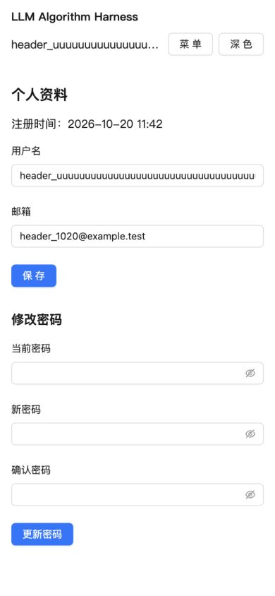
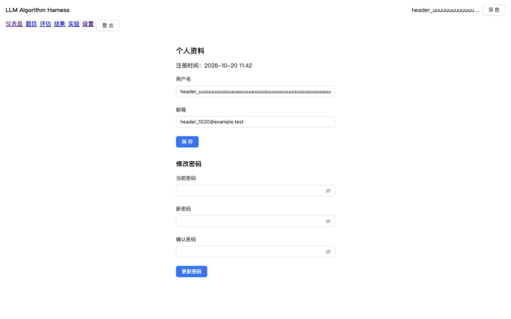

# 手机顶栏溢出修复验证

- Change：`mobile-header-overflow`
- 日期：2026-10-20
- 分支：`comet/mobile-header-overflow`
- 基线：`910ce00`，实现提交：`dd4f9e0`
- 结论：PASS

## 修复与根因消除

仅修改 AppLayout 的顶栏：手机端应用名称占第一行，用户名/菜单/主题操作占第二行；768px起恢复横排。用户名允许收缩并显示省略号，DOM文字及title保留完整身份；两个按钮均不压缩。未使用全局隐藏横向溢出的方式掩盖错误，未改变认证、路由或其他页面。

原始同一行flex布局中，长用户名的最小内容宽度会把按钮推到屏幕外。改为移动端分行、文本允许收缩、按钮保留宽度后，真实布局断言确认根因已消除。

## RED 证据

临时数据库专用账户用户名为 `header_` 加57个 `u`，总长64字符，符合现有注册规则。使用真实API注册并在浏览器登录。

390px视口下，旧实现 documentWidth=815px，横向溢出425px。用户名宽570px；菜单和主题按钮右边界分别为743.04px、814.83px。浏览器断言 `documentWidth <= viewport` 实际抛出 `RED: document overflows viewport by 425px`。

原始截图：`/tmp/mobile-header-before.jpg`。之前21字符用户名的390px/320px溢出也已在issue161补验收中记录。

## GREEN 证据

真实内置浏览器中重载修改后的页面，以同一个64字符用户名批量检查：

- 320px：documentWidth=320px，用户名显示宽144px，两按钮右边界232.21px/304px。
- 390px：documentWidth=390px，用户名显示宽214px，两按钮右边界302.21px/374px。
- 767px：documentWidth=767px，用户名空间足够时完整显示，按钮仍在视口内。
- 768px：documentWidth=768px，恢复单行，用户名最大显示宽192px，主题按钮右边界752px，手机菜单隐藏。
- 1440px：documentWidth=1440px，保持桌面单行，用户名最大显示宽192px，主题按钮右边界1424px。

所有可见顶栏按钮宽约63.79px，均位于视口内。浏览器断言同时检查：页面宽度不超过视口；按钮左右边界及宽度；手机两行/桌面一行；text-overflow为ellipsis。320、390及桌面下内容宽570px而显示宽度较小，确实发生截断。

最初脚本误要求767px也必须发生截断；该宽度可完整容纳用户名，修改此过强测试条件后重新运行所有断点通过，未因此修改源码。

浏览器交互：手机菜单展开可见六个入口；点击设置后进入设置页且菜单收起；主题切换后根节点为dark，再切回浅色；可进入个人资料页；title保留完整64字符用户名。浏览器临时视口设置已恢复默认。

布局数据：`/tmp/mobile-header-layout-results.json`。

## 截图

390px手机端：

1440px桌面端：

深色验证截图：`/tmp/mobile-header-after-dark.jpg`。

## 自动检查

提交前、提交后均通过：

- `npm --prefix frontend test`：108 passed，0 failed，0 skipped。
- `npm --prefix frontend run lint`：通过。
- `npm --prefix frontend run format:check`：通过。
- `npm --prefix frontend run build`：TypeScript及Vite生产构建通过。
- `git diff --check`：通过。
- `comet classic openspec -- validate mobile-header-overflow --strict`：通过。

最终测试日志 `/tmp/mobile-header-final-tests.log`，构建日志 `/tmp/mobile-header-final-build.log`。

## 六项轻量验证

- [x] 单项任务完成且源码已提交。
- [x] 修改与任务一致：1个源码文件，另有报告和2张截图。
- [x] 生产构建与类型检查通过。
- [x] 原始浏览器失败断言转绿，前端全量108项测试通过。
- [x] 无凭证、权限、接口或用户数据格式变化。
- [x] 按hotfix默认review_mode=off跳过独立代码审查；最终diff与浏览器截图均已检查。

规模脚本把12个Comet产物/自动元数据也计入，返回full；实际为1项任务、1个源码文件、零delta spec，因此按允许的覆盖机制采用light。

本修复恢复既有窄屏可用性，不改变规格语义，使用skip_specs。布局由浏览器会话中的自动断言验证；现有Node测试不计算CSS尺寸，因此未添加只断言class字符串的镜像测试，也未引入新的浏览器测试依赖。验证为视口模拟及鼠标/键盘交互，不代表iOS/Android真机或触控专项验收。

用户已选择 C，授权归档、推送并创建 PR。报告、截图和验证状态纳入本次归档提交；归档目录为 `openspec/changes/archive/2026-10-20-mobile-header-overflow`，归档完整性守卫通过。
